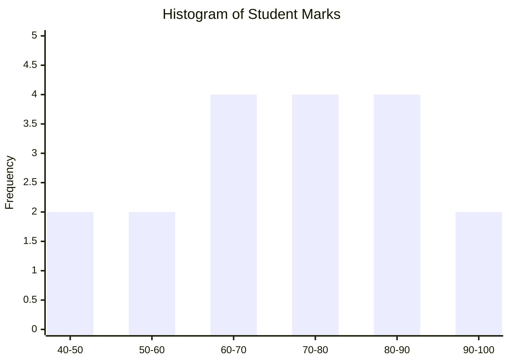

# Histogram

## Definition

A **Histogram** is a graphical representation used to display the distribution of numerical data.  
It groups data into **continuous intervals (bins)** and shows the **frequency of data points in each interval**.

Unlike bar charts, histograms represent **continuous data**, and the bars touch each other because the intervals are continuous.

---

# Example Dataset

Suppose we have the following marks of students:
[45, 50, 55, 60, 62, 65, 68, 70, 72, 75,
78, 80, 82, 85, 88, 90, 92, 95]

We divide them into class intervals:

| Marks Interval | Frequency |
| -------------- | --------- |
| 40 - 50        | 2         |
| 50 - 60        | 2         |
| 60 - 70        | 4         |
| 70 - 80        | 4         |
| 80 - 90        | 4         |
| 90 - 100       | 2         |

---

# Histogram Graph (Example)

